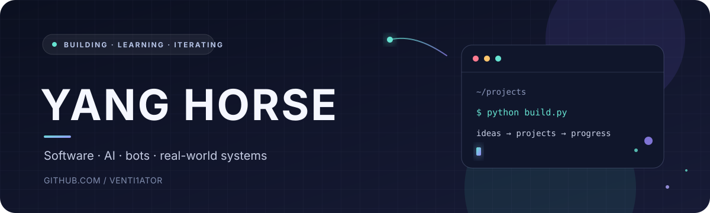

  

<h1 align="center">Yang Horse @venti1ator</h1>

  
🇷🇺 Русский

  
Привет! Я Yang Horse. Разрабатываю проекты в области чатов, календарей, AI и автоматизации. Сейчас работаю над системой камер для семи бизнесов.

  
🇬🇧 English

  
Hi, I'm Yang Horse. I build projects around messaging, calendars, AI, and automation. I'm currently working on a camera system for seven businesses.

  
🇺🇦 Українська

  
Привіт! Я Yang Horse. Працюю над проєктами у сферах чатів, календарів, AI та автоматизації. Зараз розробляю систему камер для семи бізнесів.

  
  
  
  

---

### 🚀 Проекты · Projects · Проєкти

<table>
  <tr>
    <td width="50%" valign="top">
      <h3>🔐 NEA · Encrypted Chat</h3>
      
Зашифрованный чат · Encrypted chat · Чат із шифруванням

      🔒 Private repository · Приватный репозиторий · Приватний репозиторій
    </td>
    <td width="50%" valign="top">
      <h3>💬 Chat to Chat</h3>
      
Проект чата · Chat project · Проєкт чату

      🔒 Private repository · Приватный репозиторий · Приватний репозиторій
    </td>
  </tr>
  <tr>
    <td width="50%" valign="top">
      <h3>🗓️ Calendar</h3>
      
Календарный проект · Calendar project · Проєкт календаря

    </td>
    <td width="50%" valign="top">
      <h3>📰 AI News</h3>
      
Проект AI News · AI News project · Проєкт AI News

      🔒 Private repository · Приватный репозиторий · Приватний репозиторій
    </td>
  </tr>
  <tr>
    <td width="50%" valign="top">
      <h3>🤖 Telegram Calendar Bot</h3>
      
Календарный бот для Telegram · Calendar bot for Telegram · Календарний бот для Telegram

    </td>
    <td width="50%" valign="top">
      <h3>📷 Camera System</h3>
      
Система камер для семи бизнесов · Camera system for seven businesses · Система камер для семи бізнесів

      🚧 In progress · В разработке · У розробці
    </td>
  </tr>
</table>

### 🌱 Public learning projects · Публичные учебные проекты · Публічні навчальні проєкти

- [Rock, Paper, Scissors](https://github.com/venti1ator/rock-paper-scissors) — a Python version of the classic game · версия классической игры на Python · варіант класичної гри на Python.
- [Longest Word](https://github.com/venti1ator/venti1ator-How-to-find-longest-word) — a small Python exercise · небольшое упражнение на Python · невелика вправа на Python.
- [Animated Web Demo](https://github.com/venti1ator/Web) — a Flask page with HTML, CSS, JavaScript, and a loading animation · веб-страница на Flask с анимацией загрузки · вебсторінка на Flask з анімацією завантаження.

### 🗣️ Languages · Языки · Мови

Русский · English · Українська

### 🤝 Contact · Связь · Контакт

[vasbalikoev@gmail.com](mailto:vasbalikoev@gmail.com)

---

  
  

Спасибо, что заглянули · Thanks for stopping by · Дякую, що завітали ✨

